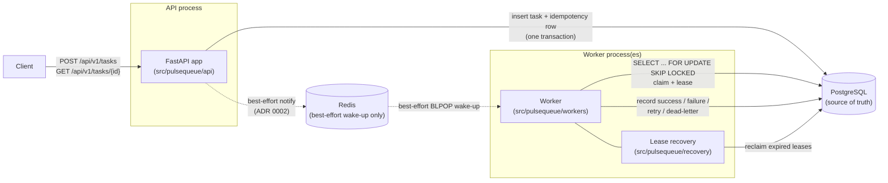
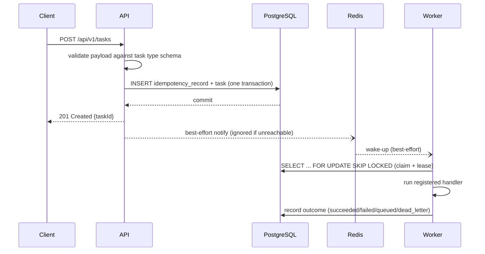

# Architecture

**Status: implemented through Phase 8.** Every component and request
flow described below exists in the repository and is covered by the
test suite — check [`README.md`](../README.md)'s implementation
status table for exactly which phase landed what.

## System diagram



Solid arrows are the correctness-critical path (always PostgreSQL);
dashed arrows are Redis's latency-optimization path, which can fail
entirely without losing a task or blocking the API (ADR 0002) - a
worker that never receives a wake-up still finds the task on its next
poll.

## Logical components

1. **FastAPI application** (`src/pulsequeue/api/`) — validates
   requests, maps domain errors to HTTP responses, exposes
   `/api/v1/*`, `/health/*`, `/metrics`.
2. **Domain layer** (`src/pulsequeue/domain/`) — `Task`, the state
   machine, retry policy calculations, and domain exceptions. No
   HTTP or SQL in this layer.
3. **Persistence layer** (`src/pulsequeue/persistence/`) — SQLAlchemy
   models, repositories, and transaction boundaries. All claim/lease
   logic lives here as explicit, testable queries.
4. **Queue adapter** (`src/pulsequeue/queueing/`) — thin Redis wrapper
   used only to wake idle workers sooner (see
   [ADR 0002](decisions/0002-redis-role-and-recovery.md)).
5. **Worker process** (`src/pulsequeue/workers/`) — polls for eligible
   tasks, claims them, runs a registered handler, records the outcome.
   Runs as a separate process from the API (`python -m
   pulsequeue.workers.worker`).
6. **Recovery** (`src/pulsequeue/recovery/`) — finds tasks whose lease
   expired and returns them to `queued`. Runs inside the same poll loop
   as the worker, not as a separate scheduled job, so there is one code
   path for "new work" and "abandoned work."
7. **Observability** (`src/pulsequeue/observability/`) — structured
   JSON logging, Prometheus metrics, liveness/readiness checks.

## Request flow (task submission)



1. Client `POST /api/v1/tasks` with a task type, payload, and optional
   `Idempotency-Key`.
2. API validates the payload against the registered schema for that
   task type; unsupported types are rejected before any database write.
3. A single PostgreSQL transaction inserts the `idempotency_records` row
   (if a key was supplied) and the `tasks` row. The unique constraint on
   idempotency key makes concurrent duplicate submissions resolve to one
   task (see [ADR 0004](decisions/0004-retry-idempotency-semantics.md)).
4. On commit, the API publishes a best-effort Redis notification and
   returns `201 Created` with the task ID and status URL.
5. A worker — already polling, or woken by the notification — claims the
   task with `SELECT ... FOR UPDATE SKIP LOCKED` plus a status/lease
   update (see [ADR 0003](decisions/0003-worker-claim-and-lease.md)).
6. The worker runs the registered handler, then records success,
   retryable failure (re-queued with backoff), permanent failure, or
   dead-letter (retries exhausted) — always as a conditional update
   guarded by `lease_owner`.
7. Metrics and structured logs record the outcome at every step above.

## Task state machine

```
queued ----(worker claims)----------> running
queued ----(cancel accepted)--------> cancelled

running ----(handler succeeds)------> succeeded
running ----(retryable, attempts<max)-> queued      (scheduled_at = now + backoff)
running ----(permanent failure)-----> failed
running ----(retryable, attempts=max)-> dead_letter
running ----(lease expires)----------> queued        (via recovery, not the worker itself)

dead_letter ----(admin requeue)-----> queued

succeeded, cancelled, failed: terminal — no transitions out.
```

Every transition is enforced in `domain/stateMachine.py`: the function
that applies a transition is given the current state and the event, and
raises a domain error for anything not in this table. This is unit
tested exhaustively (every allowed pair, and a representative sample of
disallowed pairs) rather than only tested for the "happy path."

## Delivery guarantees

- **At-least-once, not exactly-once.** A worker can run a handler to
  completion, crash before recording `succeeded`, and have the task
  reclaimed by lease recovery and run again (ADR 0003). Handlers are
  expected to tolerate being invoked more than once for the same task
  where that matters; PulseQueue cannot make an arbitrary handler
  idempotent for you.
- **Submission is deduplicated, execution is not.** An `Idempotency-Key`
  guarantees one `task` row per key (ADR 0004) - two submissions with
  the same key get back the *same* task, never two. It says nothing
  about how many times that task's handler runs; that's the at-least-
  once guarantee above.
- **No task is lost while PostgreSQL holds it.** Every state
  transition is a committed row in `tasks`/`task_attempts`; a crashed
  worker, a restarted API process, or Redis being completely
  unreachable can delay progress but cannot make a task disappear
  (ADR 0001, ADR 0002).
- **Ordering is not guaranteed.** Tasks are claimed by any available
  worker as soon as they're eligible (`scheduled_at <= now()`), not in
  strict submission order, and multiple workers claim concurrently.
  Don't build a workflow on "task B always runs after task A" unless
  B depends on A's result through the API, not through ordering alone.

## Why these boundaries

- **Domain has no I/O.** The state machine and retry-delay calculator
  are pure functions over plain data, so they're tested with no
  database, no Redis, and no real clock.
- **Persistence owns transactions.** Repository methods take and return
  domain objects; callers never see raw SQL or manage commits directly,
  which keeps "claim must be atomic" enforceable in one place.
- **Workers and the API never share process state.** The only channel
  between them is PostgreSQL (source of truth) and Redis (latency
  optimization), which is what makes "kill the worker mid-task" a valid
  test rather than undefined behavior.

See the ADRs in [`docs/decisions/`](decisions/) for the reasoning behind
the four decisions that shape this diagram.
